During the first week, we first did research about video mapping: what the industry standards are, what initial problems novice users might experience when first starting to do video mapping. One of the main insights after our research was that a lot of the already existing software is not very friendly for first time users, since they don’t really explain what each feature does and you sort of have to already have a certain level of knowledge to use them.  

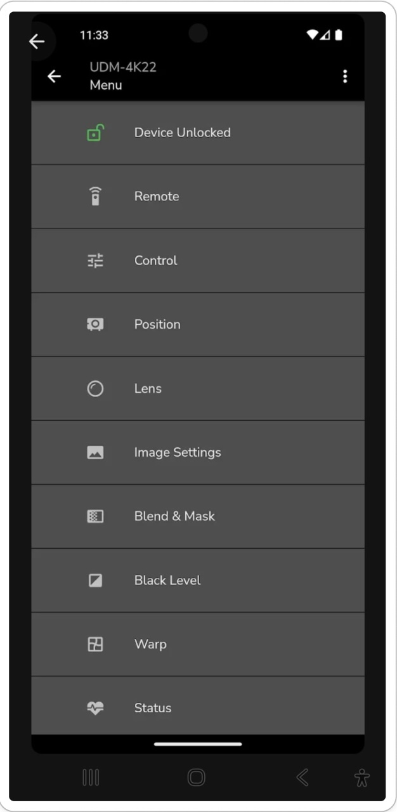

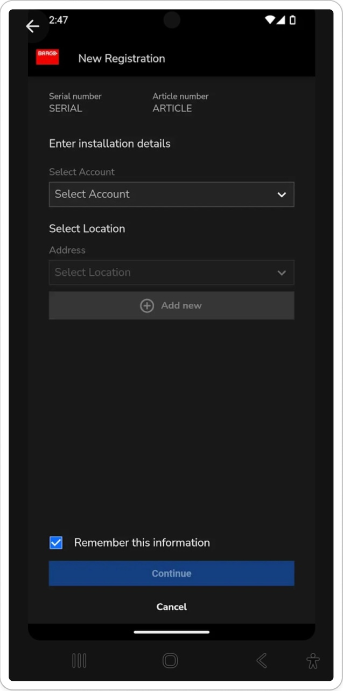

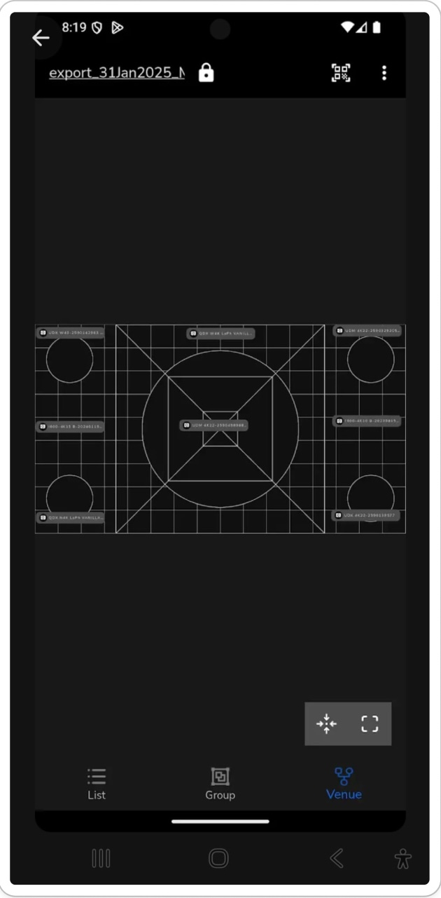

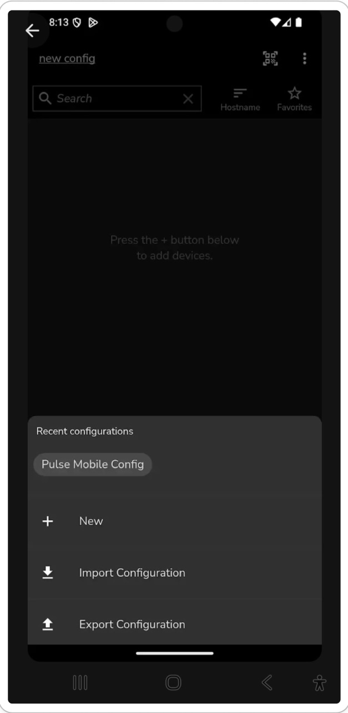

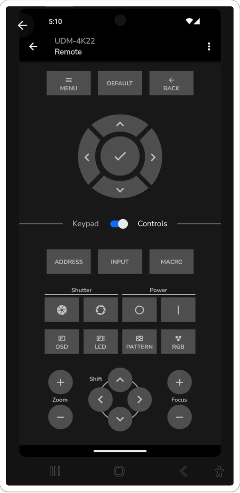

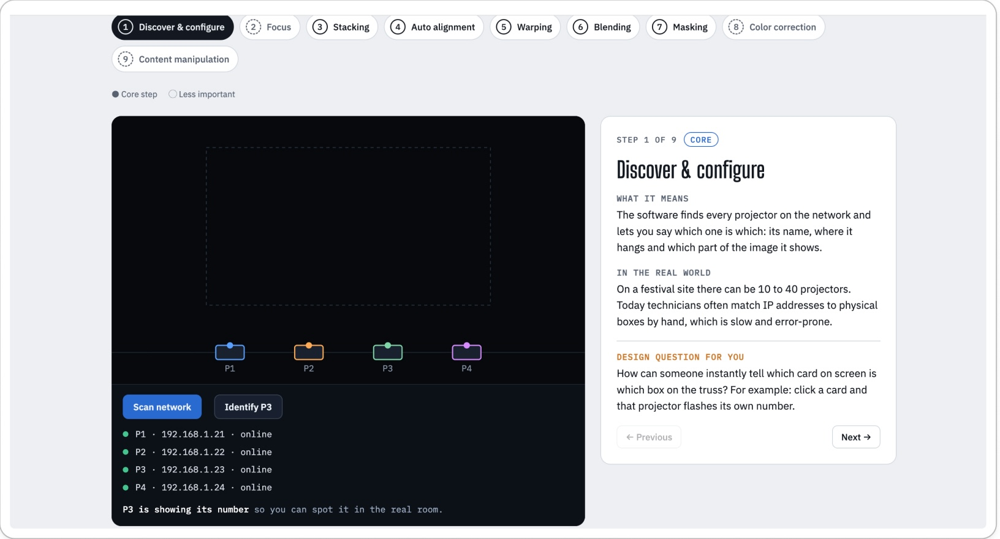

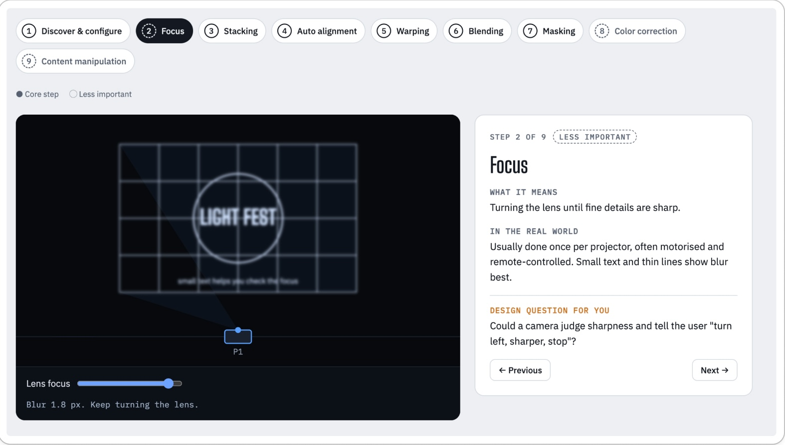

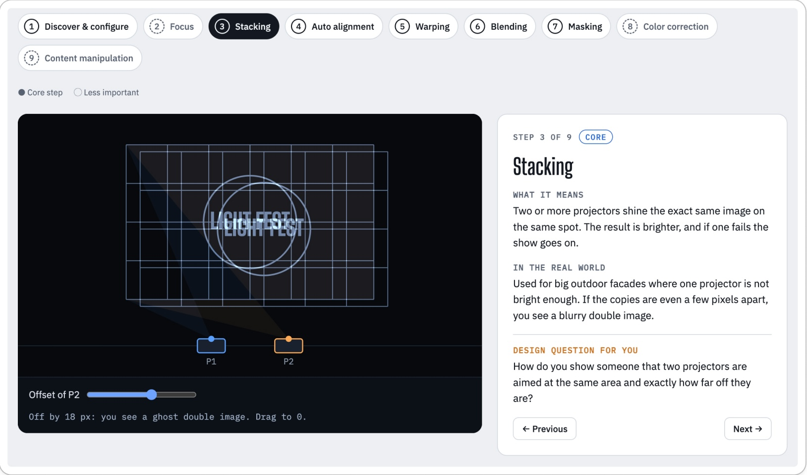

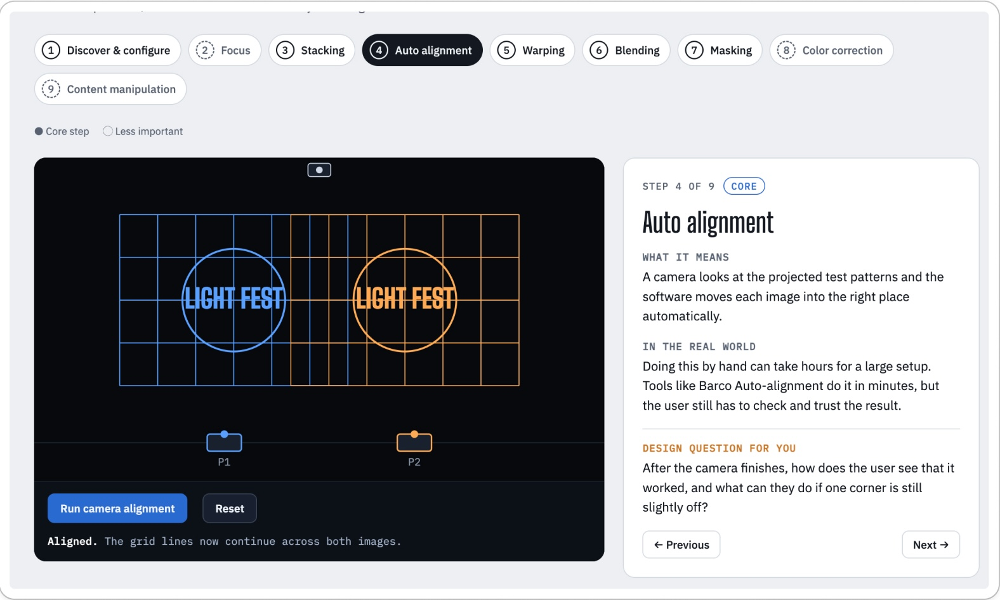

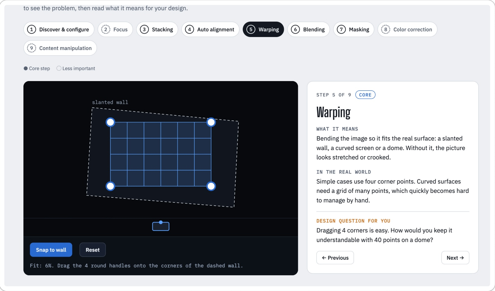

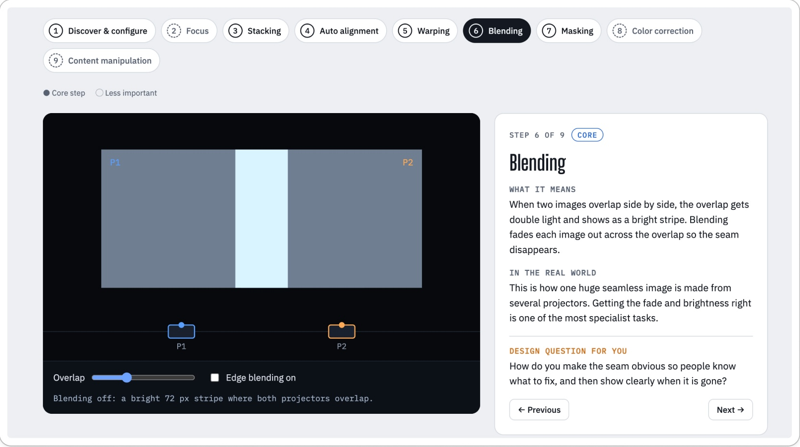

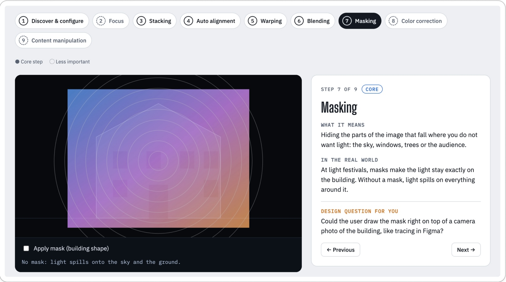

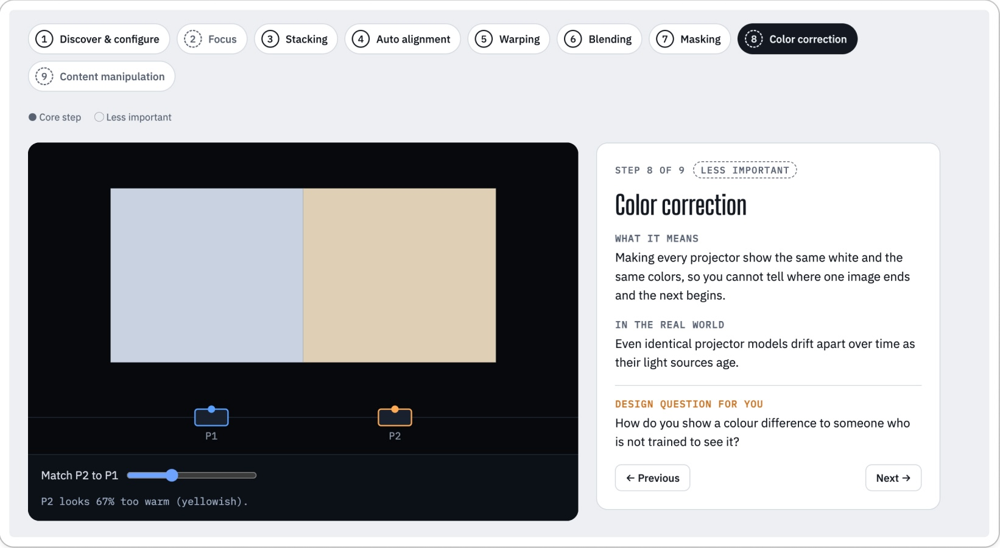

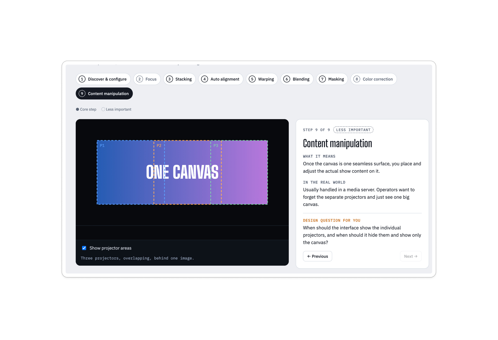

After our research we also contacted the client to clarify some details about what they want the final project to be: if there should be a mobile and desktop version, wether or not we can deviate a bit from Barco’s already existing style, what are some of the main functionalities from their already existing frameworks they would like for us to incorporate into our solution.